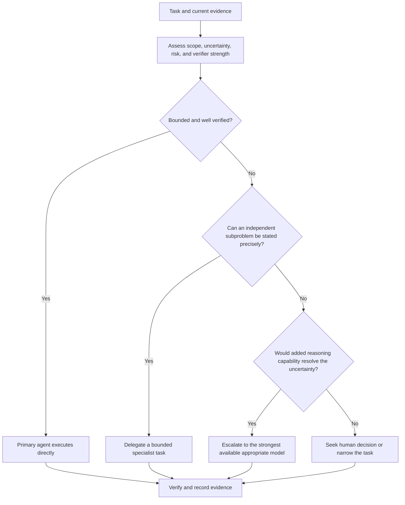

# G-011: Difficulty-Aware Task Escalation *

**Status:** Active
**Type:** General
**Domain:** Ecosystem

## Context
[G-007: Verifiability as Prerequisite](G-007-verifiability-as-prerequisite.md) establishes that the quality of a task's feedback loop should determine how aggressively an agent automates it. That judgment must also determine how an agent allocates its own work: a bounded, well-verified edit should not receive the same treatment as an ambiguous, cross-cutting, safety-critical problem.

## Problem
An agent that treats every task as equally difficult either attempts work beyond its reliable capability or spends needless coordination effort on a task it could have completed directly.

### Body of Problem
Difficulty is not an internal feeling an agent can safely trust. A fluent response can conceal uncertainty about requirements, broad implementation impact, weak verification, unfamiliar domain knowledge, or a hard reasoning problem. At the same time, delegating trivial work creates communication loss, duplicate exploration, and avoidable latency.

When an agent cannot distinguish those cases, it may press forward until it confabulates a solution, prematurely declare a task complete, or scatter an indivisible problem across agents with no accountable owner. A stronger model or specialist agent is useful only when it receives a sharply bounded question and the primary agent preserves the evidence needed to assess its answer.

## Solution
Before committing to an execution strategy, assess the task using observable difficulty signals and deliberately choose direct work, decomposition, specialist delegation, stronger-model escalation, or human direction.

### Solution Diagram

### Body of Solution

1. **Use evidence-based difficulty signals.** Assess the number of affected boundaries, the amount of unknown domain knowledge, the cost of a wrong change, the strength of available verifiers, and whether requirements are sufficiently concrete. Treat these as reasons to change the work strategy, not as reasons to bluff certainty.
2. **Keep simple work local.** Execute directly when the change is bounded, the relevant code and contract are understood, and inexpensive validation can provide strong feedback. Do not delegate merely to appear thorough.
3. **Delegate independently verifiable slices.** A delegated task must name its exact question, scope, expected evidence, and return artifact. Examples include mapping call sites, reviewing a security boundary, reproducing a failure, or evaluating a proposed design against a stated constraint. The primary agent remains responsible for synthesis and final integration.
4. **Escalate capability deliberately.** Use a stronger available model or specialist when the bottleneck is genuine reasoning depth, specialized knowledge, or independent analysis—not when the task is underspecified. Preserve the original constraints, evidence, and uncertainty in the escalation prompt so the result can be checked rather than accepted by authority.
5. **Ask for human direction when judgment is unavailable.** No model escalation can recover a product choice, authorization, or tacit preference the human has not supplied. State the concrete decision needed and continue only with an explicitly safe assumption.
6. **Close the loop with verification.** Treat delegated or escalated output as a hypothesis. Validate it with the same compiler, tests, data, or adversarial review that would be required for locally produced work.

## Consequently
The agent spends coordination and model capability where they add evidence-backed value, while preserving direct ownership of ordinary work. Escalation becomes a controlled response to observable risk and uncertainty rather than a substitute for planning or verification.

## Related Smaller Patterns
[G-007: Verifiability as Prerequisite](G-007-verifiability-as-prerequisite.md) supplies the central signal for deciding how much automation is appropriate. [G-040: Adversarial Verification Loops](G-040-adversarial-verification.md) and [G-043: Multi-Agent Council](G-043-multi-agent-council.md) provide verification and multi-perspective mechanisms once delegation is justified. [G-020: Pageable Wisdom and Context Management](G-020-pageable-wisdom.md) keeps the resulting handoff evidence compact and retrievable.
