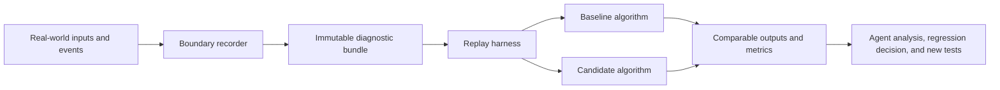

# G-023: Replayable Diagnostics and Algorithm Backtesting *

**Status:** Active
**Type:** General
**Domain:** Ecosystem

## Context
[G-022: Future-Proof Data Capture](G-022-future-proof-data-capture.md) requires raw, high-fidelity data retention so future agents can revisit past decisions. Operational diagnostics should do more than preserve history: they should let an agent deterministically replay an observed situation, organize its evidence, and evaluate a changed algorithm against the same real-world recording without recollecting the data live.

## Problem
Logs that only describe a failure force developers to infer causal ordering from fragments, while an unrecorded real-world scenario must be expensively reproduced before any algorithm change can be assessed.

### Body of Problem
Production and field behavior depend on inputs, timing, configuration, software version, environment, and event ordering. A prose report or a final aggregate metric usually loses the sequence that made the behavior meaningful. An agent can rapidly cluster, annotate, and compare diagnostic evidence, but it cannot recreate information that was never captured.

Even when a raw recording exists, it is not useful for algorithm development unless the system can feed the same inputs through a stable replay boundary and measure candidate behavior against a baseline. Without that harness, every change demands a new live capture, yielding slow iteration and weak regression protection. Conversely, a recording is not proof that an algorithm works generally; its coverage and provenance must remain explicit.

## Solution
Capture versioned diagnostic evidence at a causal boundary and make it executable as a deterministic replay fixture for analysis and algorithm backtesting.

### Solution Diagram

### Body of Solution

1. **Record the causal inputs, not only the symptoms.** Capture the ordered events, raw measurements, clock basis, relevant configuration, environment, build/version provenance, and any expected or observed outcome at the narrowest boundary that can reproduce the decision. Use a documented schema and stable event identifiers so data remains interpretable as the system evolves.
2. **Preserve an immutable raw bundle.** Store the original evidence separately from derived summaries, annotations, charts, and AI analysis. Derived artifacts can be regenerated or corrected; the raw recording is the source of truth. Redact or protect sensitive data without silently changing its meaning.
3. **Replay through the production-relevant ingress.** Feed recorded input through the same domain boundary used by the live system, with dependencies such as clocks, randomness, and external effects controlled explicitly. Do not create a parallel test-only interpretation of the recording that can drift away from production behavior.
4. **Backtest candidate algorithms.** Run a baseline and a proposed implementation against the same fixture, then compare outputs, invariants, timing, and domain metrics. This lets an agent test upgrades against valuable real-world scenarios without waiting to recollect live data. Promote representative recordings to a curated regression corpus when they expose meaningful behavior.
5. **Label coverage and limits.** Associate each recording with its scenario, acquisition conditions, schema version, and known gaps. Treat a passing replay as evidence for that recorded distribution, not as a substitute for live validation when the hardware, environment, or input distribution has changed.
6. **Make analysis repeatable.** Give agents tools to page, filter, correlate, and annotate recordings, then save conclusions as derived artifacts linked to the immutable bundle. A later agent should be able to reproduce the analysis rather than re-read an unstructured log dump.

## Consequently
Real-world behavior becomes a reusable, high-fidelity regression asset. Agents can replay incidents, compare algorithm versions, and backtest proposed changes quickly, while the organization retains the provenance and coverage limits needed to interpret the result honestly.

## Related Smaller Patterns
[G-022: Future-Proof Data Capture](G-022-future-proof-data-capture.md) establishes raw-data retention; this pattern makes retained diagnostics operational. [G-008: Eval-Driven System Design](G-008-eval-driven-system-design.md) turns replay comparisons into durable evaluation data. [G-007: Verifiability as Prerequisite](G-007-verifiability-as-prerequisite.md) and [G-042: Tool-Driven Correctness](G-042-tool-driven-correctness.md) govern the objective comparison harness.
