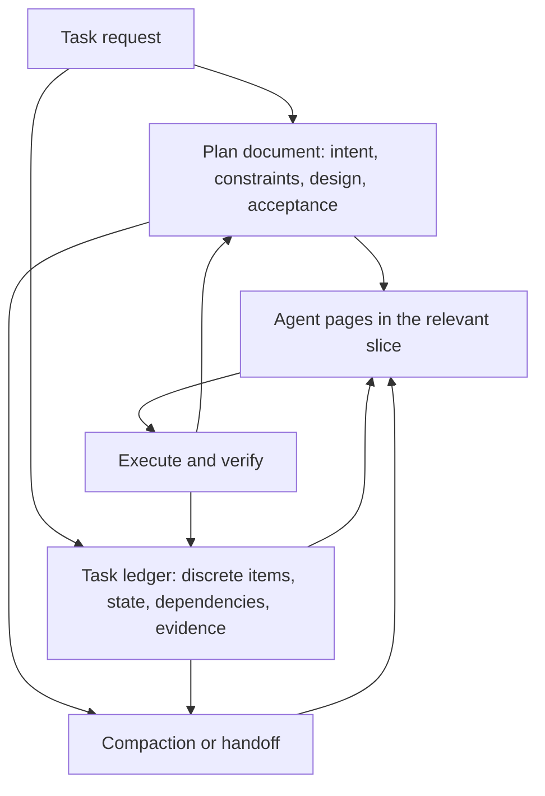

# G-024: Externalized Plans and Task Ledgers *

**Status:** Active
**Type:** General
**Domain:** Ecosystem

## Context
[G-020: Pageable Wisdom and Context Management](G-020-pageable-wisdom.md) makes durable project knowledge selectively loadable. Active work needs a complementary, more immediate form of memory: an agent must retain the intended approach and every unresolved action across long tasks, handoffs, and context compaction without repeatedly transmitting an entire plan in conversation.

## Problem
When plans and open items live only in an agent's context or chat transcript, they are repeatedly restated, become stale, and are easily dropped as the task grows or the context is compacted.

### Body of Problem
A design plan and a task checklist solve different problems. The plan explains the desired outcome, constraints, decisions, and approach; the checklist tracks discrete execution state. Combining them into a single narrative makes status hard to update, while keeping neither in a file forces agents to reconstruct both from noisy conversation history.

Repeatedly embedding the whole plan in prompts consumes context without adding information. It also obscures changes: an agent may remember an old version of the plan, mark work done without recording evidence, or lose an unresolved dependency during a handoff. A compact, file-backed execution state gives the next agent a precise starting point without treating chat as a database.

## Solution
For every non-trivial task, externalize active execution state as a paired plan document and task ledger; update the smallest affected record as work progresses.

### Solution Diagram

### Body of Solution

1. **Write a concise plan document.** Record the objective, non-goals, constraints, chosen approach, important decisions, architecture or interface changes, and acceptance evidence. Update it when the intended design changes; do not turn it into a chronological activity log.
2. **Maintain a separate task ledger.** Give every actionable item a stable identifier, bounded scope, status, dependencies or blocker, owner when relevant, and verification evidence when completed. A checkbox alone is insufficient when a later agent needs to know what was proven or what remains uncertain.
3. **Page in only the necessary state.** Before acting, read the plan and the task items relevant to the next decision. During execution, edit the affected task status, evidence, or dependency instead of re-emitting the entire plan into the context window. Use links or stable identifiers to connect tasks to plan sections, code, recordings, and validation output.
4. **Make handoff and compaction recoverable.** A new or resumed agent should begin from the plan and current task ledger, not reconstruct the task from chat. Record the exact next action and any blocker before yielding control; record verification results before declaring work complete.
5. **Keep execution state bounded and current.** Split large plans into topical documents, archive completed ledgers with their outcome, and remove superseded tasks rather than leaving ambiguous duplicate instructions. Promote reusable, long-lived lessons from the plan into the pageable pattern language rather than forcing future tasks to load old project plans.

## Consequently
Plans remain a stable representation of intent while task ledgers provide a compact, auditable source of execution truth. Agents spend context on the current decision instead of repeating stale prose, and open work survives compaction, delegation, and handoff with less risk of omission.

## Related Smaller Patterns
[G-020: Pageable Wisdom and Context Management](G-020-pageable-wisdom.md) supplies the broader lazy-loading principle. [G-021: Saliency and Conflict Resolution](G-021-saliency-and-conflict-resolution.md) keeps the current constraints visible when plans change. [G-041: Inline Verification Checklists](G-041-inline-verification-checklists.md) supplies a focused verification mechanism for individual ledger items, while [G-022: Future-Proof Data Capture](G-022-future-proof-data-capture.md) preserves the evidence behind important completed work.
