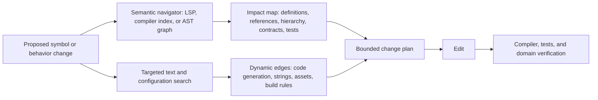

# G-044: Semantic Graph-Guided Change Analysis *

**Status:** Active
**Type:** General
**Domain:** Ecosystem

## Context
[G-004: Compiler-Driven Validation](G-004-compiler-driven-validation.md) proves whether a typed program is valid after a change, and [G-042: Tool-Driven Correctness](G-042-tool-driven-correctness.md) generalizes that feedback loop. Before editing, an agent also needs evidence of what the change can affect. Language servers, compiler indexes, and AST-derived graphs expose relationships that text search alone cannot reliably recover.

## Problem
An agent that changes code based only on filename intuition or textual search can miss callers, implementations, overrides, generated contracts, and other semantically connected usages, causing incomplete or subtly incompatible edits.

### Body of Problem
Text search is fast and indispensable, but it cannot distinguish a symbol from a comment, identify a protocol conformance, resolve a renamed import, or reliably map a type hierarchy. It also commonly misses code generated from schemas and configuration-driven dependencies. An agent working from a partial view may update the obvious declaration while leaving a downstream implementation, test fixture, build target, or public API inconsistent.

Semantic graphs are not omniscient: reflection, string-based registration, dynamic dispatch, build scripts, assets, and remote contracts can sit outside a language server's graph. The goal is not to claim perfect static coverage; it is to replace intuition with the strongest available structural evidence and clearly identify what remains outside it.

## Solution
Before making a non-local change, use the strongest available semantic navigation surface—preferably LSP, compiler index, or AST graph—to build and verify an explicit impact map; supplement it with targeted text and configuration search for dynamic edges.

### Solution Diagram

### Body of Solution

1. **Establish semantic navigation early.** Configure and use the project’s Language Server Protocol tooling, compiler index, or AST analysis before performing cross-cutting work. Prefer project-native tooling that resolves actual symbols and types over ad hoc guesses about naming conventions.
2. **Build an explicit impact map.** For every changed symbol or behavior, inspect its declaration, references, callers or consumers, implementations and overrides, type or protocol relationships, public contracts, related tests, and generated-code source where applicable. Record the affected boundaries in the working plan or task ledger before editing.
3. **Use text search as a complementary surface.** Search for configuration keys, serialized names, string registrations, feature flags, assets, build rules, documentation, and external schemas that may lie outside the semantic graph. Do not present text search alone as complete impact evidence when semantic tooling is available.
4. **Label static and dynamic confidence separately.** State what the graph proves and what it cannot see. Treat reflection, runtime routing, code generation, and external services as hypotheses requiring targeted inspection or runtime validation rather than silently assuming they are absent.
5. **Validate the resulting graph after the edit.** Re-run affected reference queries, compile or type-check, execute focused tests, and use domain-specific verification. A change is not complete merely because all known text occurrences were updated.

## Consequently
The agent plans changes from a codebase’s actual structural relationships, reducing missed usages and making verification scope explicit. LSP and AST graphs provide the semantic backbone; targeted searches and runtime checks cover the dynamic edges that static analysis cannot prove.

## Related Smaller Patterns
[G-001: Strongly Constrained Tools](G-001-strongly-constrained-tools.md) favors bounded tools that return trustworthy structural evidence. [G-004: Compiler-Driven Validation](G-004-compiler-driven-validation.md) and [G-042: Tool-Driven Correctness](G-042-tool-driven-correctness.md) validate the changed graph. [G-007: Verifiability as Prerequisite](G-007-verifiability-as-prerequisite.md) determines how much confidence the available static and dynamic checks warrant.
