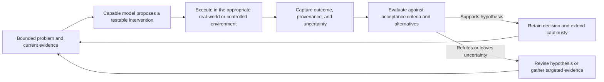

# G-046: Empirical Intelligence Compounding *

**Status:** Active
**Type:** General
**Domain:** Ecosystem

## Context

[G-007: Verifiability as Prerequisite](G-007-verifiability-as-prerequisite.md) explains why a reliable feedback signal governs the quality of an AI loop. [G-008: Eval-Driven System Design](G-008-eval-driven-system-design.md) turns that principle into product instrumentation. This pattern connects them through an operating model: the useful unit of intelligence is not one model invocation, but a system that repeatedly applies capable reasoning to reality, learns from the result, and preserves what it learned.

⋇ ⋇ ⋇

## Problem

Teams can over-focus on the presumed intelligence ceiling of a single model and under-invest in the system that gives that model real-world feedback. A capable model without observation, measurement, and revision produces plausible hypotheses; it does not reliably accumulate applied capability.

### Body of Problem

There may be hard or practical limits to what a fixed model can infer from its training and a single context. Those limits are not usefully managed by assigning an ungrounded scalar IQ to a model. What matters operationally is whether the system can turn an uncertain proposal into a tested intervention, observe the outcome, retain provenance, and revise the next proposal.

Iteration alone is not enough. Repeating a model's preferred answer without new evidence compounds error and sunk cost. Likewise, raw field data without an accountable hypothesis, comparison, or decision rule becomes an archive rather than learning. The loop must make causal claims and uncertainty visible, distinguish simulation from live evidence, and connect each observation to a concrete next decision.

## Solution

Build **Empirical Intelligence Compounding Loops**: repeatedly apply capable models to a bounded real-world hypothesis, measure the resulting outcome, preserve the evidence and provenance, and revise the next intervention through explicit evaluation.

### Solution Diagram

### Body of Solution

1. **Start with a bounded, testable hypothesis.** State the proposed intervention, the expected observable result, the relevant constraints, and the acceptance criterion. A model may generate the hypothesis, but it must be specific enough to expose itself to evidence.
2. **Apply the strongest appropriate reasoning where it changes the next experiment.** Use capable general or specialist models to form hypotheses, interpret evidence, and suggest discriminating tests. Escalation is useful when it improves the next decision; it is not proof that an answer is correct.
3. **Make contact with reality.** Execute the intervention in the appropriate environment: production, a representative device, a controlled experiment, a replay harness, or a human evaluation. Label the evidence source and do not present simulation-only or unverified results as field confirmation.
4. **Capture outcomes with provenance.** Retain the input, intervention, model/configuration, environment, timing, observed output, and known uncertainty. Keep raw evidence accessible alongside the evaluated conclusion so later models and humans can challenge or reprocess it.
5. **Evaluate hypotheses, not model confidence.** Compare the observed outcome with predeclared acceptance criteria, a baseline, and viable alternatives. Use objective tools where possible; where judgment is required, use calibrated human review or designed evaluations.
6. **Revise the system, not merely the prompt.** Feed the result into the next hypothesis, test fixture, tool boundary, model selection, workflow, or product decision. Record both successful and rejected approaches so the loop compounds learning instead of revisiting the same plausible mistake.
7. **Stop or escalate honestly.** When evidence is insufficient, a real-world test is unsafe or unauthorized, or evaluation cannot distinguish alternatives, retain the uncertainty and seek the missing authority or measurement. Do not turn iteration count into evidence of progress.

⋇ ⋇ ⋇

## Related Smaller Patterns

[G-007: Verifiability as Prerequisite](G-007-verifiability-as-prerequisite.md) determines the strength of the evaluation boundary. [G-008: Eval-Driven System Design](G-008-eval-driven-system-design.md) provides the instrumentation that produces evaluation-ready evidence. [G-022: Future-Proof Data Capture](G-022-future-proof-data-capture.md) preserves raw evidence for later reprocessing, and [G-023: Replayable Diagnostics and Algorithm Backtesting](G-023-replayable-diagnostics-and-algorithm-backtesting.md) makes repeated experiments economical. [G-011: Difficulty-Aware Task Escalation](G-011-difficulty-aware-task-escalation.md) governs model and specialist escalation, while [G-040: Adversarial Verification Loops](G-040-adversarial-verification.md) and [G-043: Multi-Agent Council](G-043-multi-agent-council.md) produce competing hypotheses worth testing.
