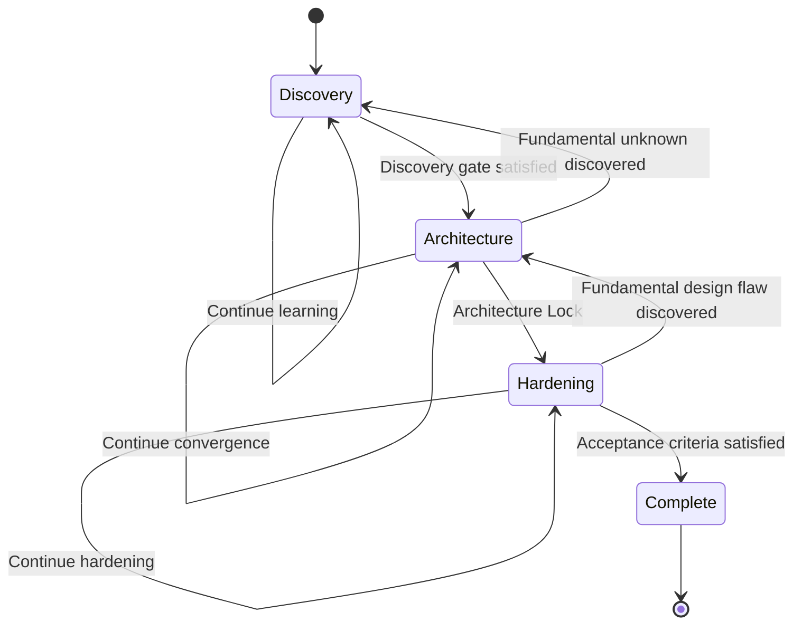
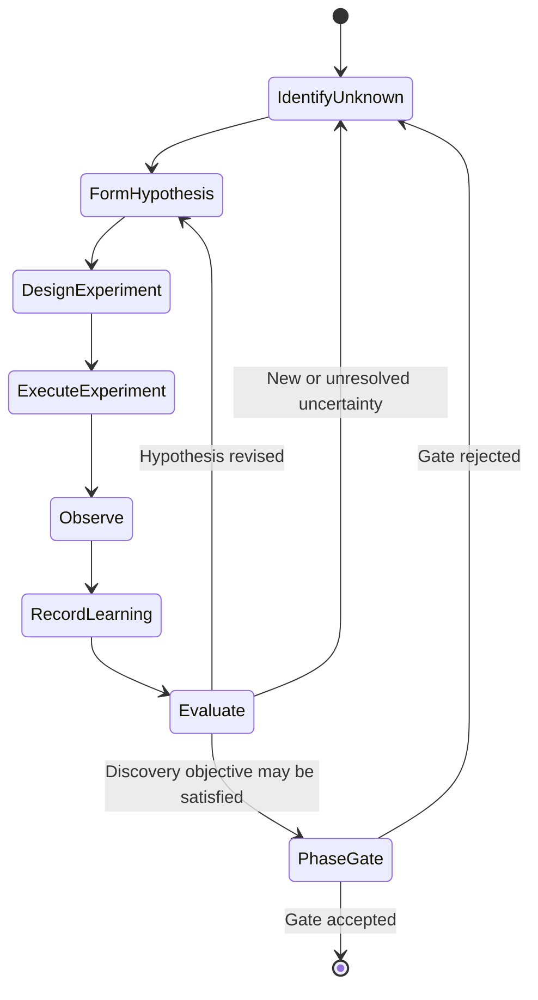
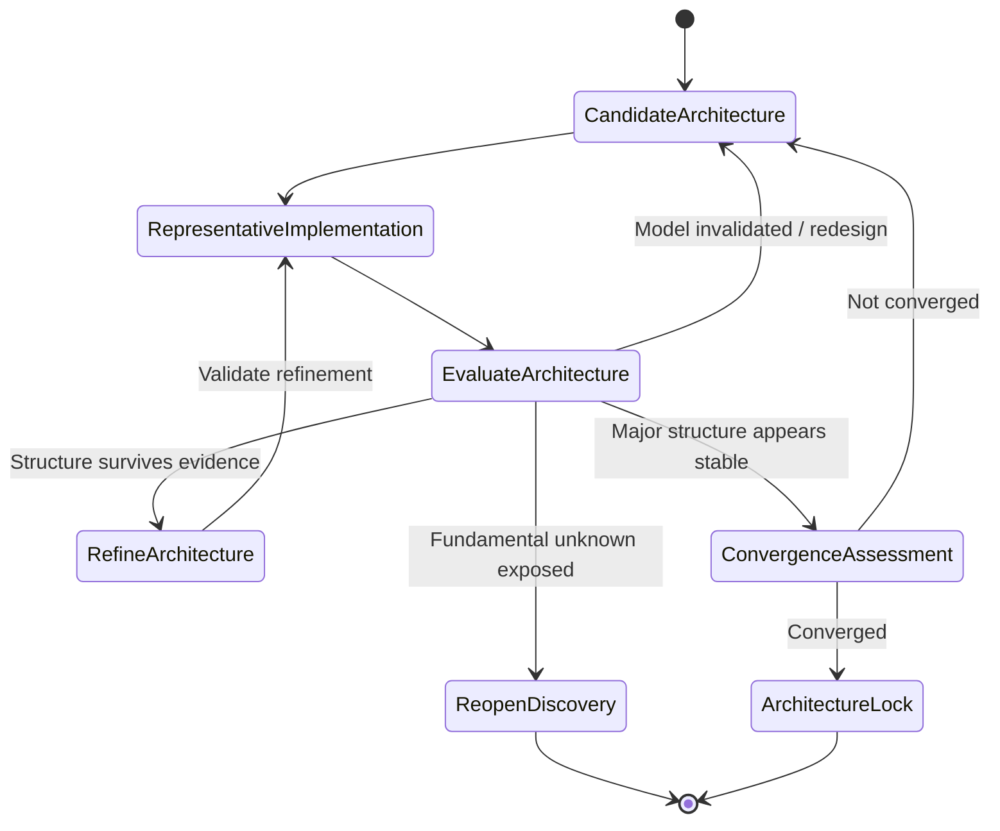
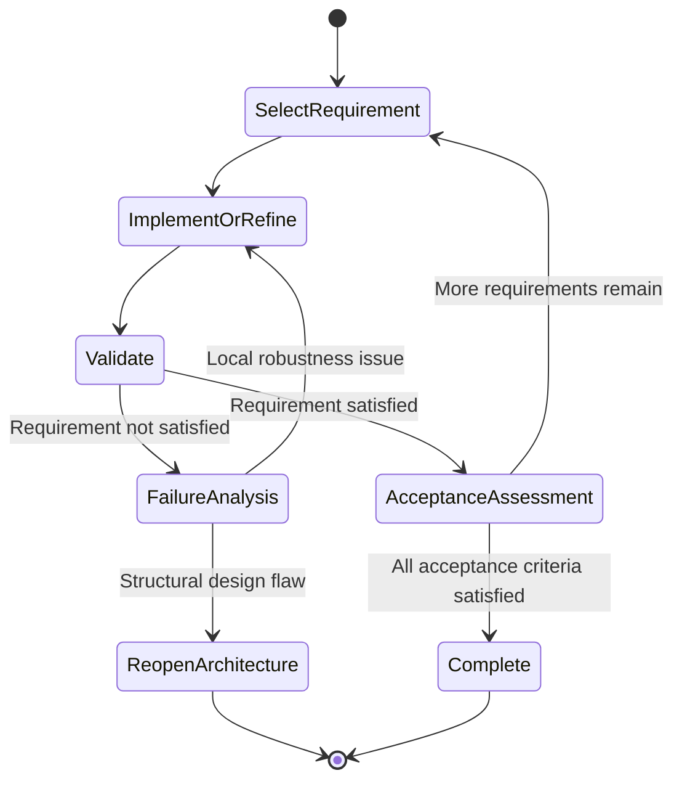

# Iterative AI Development Constitution

## 1. Purpose

The default coding harnesses in Codex, Claude, Antigravity, etc use a relatively generic, output-biased approach. Therefore, they do not implement an SDLC process/philosophy customized to the project or tastes of the host organization.

This constitution overrides the default SDLC behaviors of the harness in favor of a specific and opinionated approach.

This constitution is heavily influenced by [A Pattern Language for Building Software with AI](https://github.com/apinstein/pattern-language-building-with-ai).

Based on the empirical observation that it often takes several major iterations to arrive at a good design for a particular problem, this constitution optimizes for this approach. Any requested changes to a software project with navigate a three-phase process:

1. Learning & Exploration
2. System Design & Architecture
3. Optimization

AI makes implementation cheap enough that early code should often be treated as an experiment rather than an asset. We therefore do not assume that the first plausible design should become the production design.

The governing principle is:

> **Early progress is measured by what we learn. Later progress is measured by what we can reliably ship.**

Code, plans, prototypes, and architecture are instruments for acquiring knowledge until the design has earned stability.

---

## 2. Core Principles

### 2.1 Learning precedes commitment
When important uncertainty remains, prefer experiments that expose reality over additional speculation.

A prototype that invalidates an assumption is successful even if none of its code survives.

### 2.2 Rewrites are expected
Early implementations are disposable by default. Do not preserve an architecture merely because code already exists.

When new evidence undermines the current design, prefer a clean redesign over accumulating patches around a bad abstraction.

### 2.3 Phase determines behavior
Every significant change goes through explicit phases. The phase tells agents what kind of work is appropriate and, equally importantly, what work is premature.

Different changes within the same project may be in different phases.

### 2.4 Evidence beats plausibility
Reasoning, reviews, and adversarial analysis are useful, but they cannot fully substitute for building and interacting with the system.

When inexpensive empirical evidence is available, acquire it.

### 2.5 Knowledge is a first-class artifact
The project must preserve not only what was built, but also:

- what was tried;
- what was learned;
- what failed and why;
- which assumptions were invalidated;
- which decisions were made and on what evidence;
- which uncertainties remain.

### 2.6 Do not confuse activity with progress
More code, tests, documentation, or completed tasks do not necessarily mean the design is converging.

During exploratory phases, the primary measure of progress is **meaningful reduction of uncertainty**.

### 2.7 Avoid premature robustness
Do not heavily optimize, generalize, polish, or build exhaustive test infrastructure around a design that may still be discarded.

Testing during early phases should primarily support experiments and protect conclusions. Production-grade testing belongs after architectural convergence.

### 2.8 Context degradation is expected
Long-running AI agents tend to drift toward local completion, minimal patches, and shipping behavior as context grows.

The process must therefore make current phase, state, constraints, unresolved questions, and exit criteria easy to recover from durable artifacts rather than conversational history.

---

## 3. Unit of Work: The Change

A **change** is any feature, subsystem, architectural modification, or sufficiently complex problem that deserves an independent learning cycle.

Each significant change receives a durable workspace, for example:

```text
changes/
  <change-name>/
    STATE.md
    1-discovery/
      STATE.md
      PLAN.md
      LEARNINGS.md
      DECISIONS.md
    2-architecture/
      STATE.md
      PLAN.md
      LEARNINGS.md
      DECISIONS.md
    3-hardening/
      STATE.md
      PLAN.md
      LEARNINGS.md
      DECISIONS.md
```

The exact filenames are conventional rather than sacred. The semantic roles are required.

---

## 4. Phase Model

The process has three major phases. A phase may contain **multiple iterations**. Phase transitions are earned by evidence, not iteration count.

### Phase 1 — Discovery & Proof of Concept

**Objective:** understand the problem and eliminate important unknowns cheaply.

Typical work includes:

- identifying assumptions and unknowns;
- building narrow proofs of concept;
- probing APIs, libraries, data, interfaces, performance characteristics, and user interactions;
- testing how components behave individually;
- testing risky integration seams;
- comparing multiple approaches;
- deliberately attempting to falsify promising designs.

Production architecture is not the goal.

Code written here should normally be assumed disposable.

#### Phase 1 exit condition

Advance only when the important unknowns that would prevent meaningful architectural design have either:

1. been answered with evidence; or
2. been explicitly accepted as residual risks.

If the team still cannot explain the important constraints and failure modes of the problem, remain in Phase 1.

---

### Phase 2 — Architecture & Convergence

**Objective:** discover a system structure that survives contact with implementation.

Using Phase 1 evidence, design the system as if starting fresh. Do not automatically evolve the proof-of-concept architecture.

Typical work includes:

- generating and comparing candidate architectures;
- defining boundaries, responsibilities, interfaces, and data flows;
- implementing enough of the architecture to expose hidden coupling and incorrect abstractions;
- exercising representative end-to-end paths;
- revisiting decisions when implementation produces contradictory evidence;
- rewriting substantial portions when warranted.

Multiple architectural iterations are expected.

The goal is **convergence**, not merely a functioning implementation.

#### Architectural convergence

Architecture is converging when successive iterations primarily produce refinements rather than replacements.

Signals include:

- major component boundaries remain stable;
- new requirements fit without unnatural workarounds;
- implementation repeatedly validates rather than overturns the model;
- major unknowns have become localized engineering questions;
- remaining changes increasingly concern robustness, ergonomics, performance, and completeness.

#### Phase 2 exit condition: Architecture Lock

Architecture may be locked when the evidence indicates that another broad redesign is unlikely to produce enough benefit to justify its cost.

Architecture Lock is a deliberate decision, recorded in `DECISIONS.md` and reflected in `STATE.md`.

Lock does **not** mean architecture can never change. It means architectural changes now require explicit justification rather than being the default mode of iteration.

---

### Phase 3 — Hardening, Optimization & Delivery

**Objective:** turn the converged design into a reliable product.

Only now should the project aggressively invest in assets whose value depends on architectural stability.

Typical work includes:

- comprehensive test matrices;
- edge-case handling;
- reliability and failure recovery;
- observability;
- security hardening;
- performance optimization;
- maintainability and refactoring;
- compatibility and migration behavior;
- operational tooling;
- user-facing polish;
- production documentation.

Phase 3 should optimize the system rather than continually rediscover its basic shape.

If hardening repeatedly exposes fundamental architectural flaws, explicitly **reopen Phase 2** rather than creating a patch spiral.

---

## 5. State Machines

The process is governed by one overall change lifecycle and one operational state machine for each phase.

The overall state machine determines **which mode of work applies**. The phase-specific state machine determines **what kind of action should happen next inside that mode**.

Each phase-level `STATE.md` must identify its current state using the conceptual states below, giving every agent an explicit **you are here** marker.

### 5.1 Overall change lifecycle



The change-level `STATE.md` records the current node in this lifecycle.

### 5.2 Discovery state machine



Discovery cycles until the important unknowns blocking meaningful architectural design have been answered or explicitly accepted as residual risks.

### 5.3 Architecture state machine



A functioning implementation is not itself evidence of convergence. Architecture remains in this loop until implementation increasingly validates rather than overturns the system model.

### 5.4 Hardening state machine



Hardening failures must be classified before being fixed. Local failures remain in Hardening; structural failures explicitly reopen Architecture rather than being hidden beneath patches.

### 5.5 State-machine discipline

State machines are operational constraints, not decorative diagrams. Agents must identify both the current change-level phase and the current phase-level state before working, perform work appropriate to that state, and update the relevant state file whenever evidence causes a transition.

Agents must use explicit backward transitions when evidence invalidates assumptions from an earlier state or phase. They must not silently jump ahead because a later activity is easier to execute or appears closer to shipping.

---

## 6. Required Artifacts

### 6.1 `STATE.md` — Current operational truth

State exists at **two levels**: the change and the active phase.

Plans describe intended approach. State describes what is actually true **right now**. State files should be deliberately short, frequently updated, and optimized for agent resumption. They are not histories; durable history belongs in `LEARNINGS.md` and `DECISIONS.md`.

#### Change-level `STATE.md`

The change-level state file is the first change-specific document an agent should read. It acts as the router for the entire change.

```markdown
# Change State

Phase: 2 — Architecture
Phase State: EvaluateArchitecture
Architecture Lock: No
Status: Active

## Current top-level objective
...

## Active phase
- `2-architecture/STATE.md`

## Global blockers
- ...

## Cross-phase unresolved questions
- ...

## Current phase gate
...

## Next top-level actions
- [ ] ...

## Relevant artifacts
- ...

## Last meaningful transition
...
```

It answers:

> **Where is this change in its overall lifecycle, and where should an agent go next?**

It should not duplicate all operational detail from the phase-level state file.

#### Phase-level `STATE.md`

Every phase directory has its own `STATE.md`. It records live operational state **inside that phase** and corresponds directly to a node in that phase's Mermaid state machine.

```markdown
# Architecture State

State: EvaluateArchitecture
Iteration: 3
Status: Active

## Current objective
...

## Current hypothesis / approach
...

## Active questions
- ...

## Current work
...

## Evidence being evaluated
- ...

## Known blockers
- ...

## Next actions
- [ ] ...

## Phase exit criteria status
- [ ] ...
- [x] ...

## Relevant artifacts
- ...

## Last meaningful learning
...
```

The exact fields may vary by phase, but every phase state file must make clear the current state-machine node, current iteration or experiment where relevant, immediate objective, active questions, current work, next actions, blockers, phase-exit status, and pointers to relevant artifacts.

It answers:

> **What exactly are we doing now, why are we doing it, and what transition are we trying to earn?**

When a phase becomes inactive, its final state remains as a historical snapshot unless that phase is explicitly reopened.

#### State synchronization

The change-level and phase-level state files must agree.

When a phase transition occurs:

1. update the outgoing phase `STATE.md`;
2. record durable conclusions in `LEARNINGS.md` and `DECISIONS.md`;
3. update the change-level `STATE.md`;
4. initialize or reactivate the incoming phase `STATE.md`;
5. ensure the recorded state corresponds to the appropriate Mermaid state machine.

The repository may additionally maintain a project-level state file summarizing all active changes and their phases.

---

### 6.2 `PLAN.md` — Intent and evaluation

A plan should state:

- the problem being addressed;
- the current objective;
- important assumptions;
- known unknowns;
- proposed experiments or implementation work;
- expected observations;
- acceptance or exit criteria;
- explicit non-goals appropriate to the current phase.

Plans should answer not merely **what will we build?**, but **what are we trying to learn or establish?**

---

### 6.3 `LEARNINGS.md` — Empirical memory

Record durable discoveries, especially surprising ones.

Each significant learning should ideally capture:

```markdown
## Learning

Observation:

Evidence:

Previous assumption:

Updated understanding:

Implication:

Confidence:
```

Failed approaches belong here when the failure teaches something likely to matter later.

Do not repeatedly rediscover known failures.

---

### 6.4 `DECISIONS.md` — Decision record

Record consequential decisions and their rationale.

```markdown
## Decision

Decision:

Context:

Alternatives considered:

Evidence:

Why this choice:

Confidence:

What would cause us to reconsider:
```

A decision without reconsideration criteria risks becoming dogma.

---

## 7. Uncertainty Discipline

Every phase should maintain an explicit model of uncertainty.

Useful categories include:

- **Known:** supported by adequate evidence.
- **Hypothesized:** plausible but not adequately tested.
- **Unknown:** recognized gap in understanding.
- **Assumed:** deliberately accepted without current validation.

Agents should preferentially attack uncertainties that combine:

1. high architectural impact;
2. high probability of being wrong; and
3. low cost of obtaining evidence.

When deciding what to do next, ask:

> **What is the cheapest action that could materially change our understanding or design?**

---

## 8. Phase Gates

Phase transitions are explicit decisions, not passive drift.

Before advancing, an agent must evaluate the relevant exit criteria and record the result.

A useful gate review asks:

- What important questions did this phase need to answer?
- What evidence answers them?
- What remains unknown?
- Which assumptions remain untested?
- What evidence would cause us to reverse the proposed transition?
- Are we advancing because uncertainty has fallen, or because we are tired of exploring?

If the evidence does not support transition, remain in the phase.

---

## 9. Agent Operating Rules

Every agent working on a governed change should follow this startup sequence:

1. Read this constitution.
2. Read the project's current state.
3. Read the change-level `STATE.md`.
4. Follow its pointer to the active phase and read that phase's `STATE.md`.
5. Confirm the current state-machine node and available transitions.
6. Read the current phase `PLAN.md`.
7. Read relevant learnings and decisions.
8. Inspect the relevant code.
9. Confirm that the intended action is appropriate for both the current phase and current phase state.
10. Work.
11. Update state files whenever meaningful operational state changes.
12. Update durable learnings and decisions whenever the state of knowledge changes.

### Agents MUST NOT

- optimize for task completion at the expense of the current phase objective;
- silently change phases;
- treat existing code as evidence that the current design is correct;
- patch around a fundamental architectural failure merely to make a task pass;
- build large amounts of production scaffolding around intentionally disposable experiments;
- erase failed experiments whose lessons remain valuable;
- allow conversational context to become the sole repository of important project knowledge;
- declare uncertainty resolved without evidence.

### When stuck

Do not default to increasingly narrow patches.

Instead ask:

1. Is the current mental model wrong?
2. Is an assumption untested?
3. Has implementation revealed evidence that should reopen an earlier decision?
4. Would a smaller experiment answer the question faster?
5. Should the current approach be discarded rather than repaired?

A sequence of hacks that repeatedly exposes new failures is evidence that the process may need to move **backward in phase**.

---

## 10. Testing Strategy by Phase

Testing serves different purposes at different phases.

### Phase 1
Test to **learn**.

Use narrow experiments, assertions, probes, fixtures, and temporary harnesses. Preserve tests only when they encode durable knowledge.

### Phase 2
Test to **validate architecture**.

Prioritize representative end-to-end flows, boundaries, contracts, integration seams, and architectural assumptions.

Avoid exhaustive matrices until the design stabilizes.

### Phase 3
Test to **establish reliability**.

Build the comprehensive test matrix: unit, integration, end-to-end, regression, performance, failure modes, security, compatibility, and other production requirements as appropriate.

---

## 11. Documentation Lifecycle

Documentation has two classes.

### Working artifacts

Phase plans, experiments, learnings, state files, and decision records exist to support the design process. They may become historical but should remain available for forensic understanding.

### Evergreen documentation

Evergreen documentation describes the system **as it currently exists and is intended to be used or maintained**.

Examples include:

- architecture documentation;
- API contracts;
- operational runbooks;
- developer guides;
- user documentation.

Do not continuously force exploratory thinking into evergreen documentation.

At Architecture Lock and again before completion, promote durable conclusions from working artifacts into evergreen documentation.

The working history explains **why**. Evergreen documentation explains **what is true now**.

---

## 12. Artifact Shelf Life

Project knowledge should make its expected lifetime clear.

Suggested classifications:

- **Ephemeral** — experiment-specific; safe to discard after conclusions are recorded.
- **Phase-local** — useful during the current phase but not canonical afterward.
- **Historical** — retained because it explains prior decisions or failures.
- **Evergreen** — canonical current documentation that must remain synchronized with the system.

Promotion from temporary to evergreen should be deliberate.

---

## 13. Branch and Commit Signaling

Where useful, encode phase in branch naming so the development environment continually reinforces the mode of work.

For example:

```text
p1/<change>/...
p2/<change>/...
p3/<change>/...
```

or:

```text
discovery/<change>/...
architecture/<change>/...
hardening/<change>/...
```

Commit messages may similarly distinguish experiments, learnings, architectural decisions, and production changes.

The purpose is not bureaucracy. It is to make accidental phase confusion harder.

---

## 14. Rewind Rule

When evidence contradicts the assumptions of the current phase, move backward explicitly.

Do not conceal a rewind by continuing to patch forward.

Examples:

- A Phase 3 optimization reveals an invalid component boundary → reopen Phase 2.
- Phase 2 reveals that a critical external system behaves differently than assumed → reopen the relevant Phase 1 investigation.

Backward movement is not failure. It is the mechanism by which evidence corrects the design.

---

## 15. Definition of Progress

Progress depends on phase.

### In Discovery
Progress = important uncertainty eliminated per unit effort.

### In Architecture
Progress = convergence toward a design that survives implementation evidence.

### In Hardening
Progress = increased confidence that the converged system satisfies its production requirements.

Merged code is therefore neither necessary nor sufficient evidence of progress.

---

## 16. Final Principle

AI dramatically lowers the cost of producing implementations. It does not eliminate the need to discover the correct problem model, abstractions, boundaries, interactions, or product behavior.

Therefore:

> **Use cheap implementation to purchase expensive understanding.**

Build early versions aggressively. Become attached to their lessons, not their code. Preserve the information produced by each cycle, redesign when the evidence demands it, and invest heavily in robustness only after the system has earned architectural stability.
