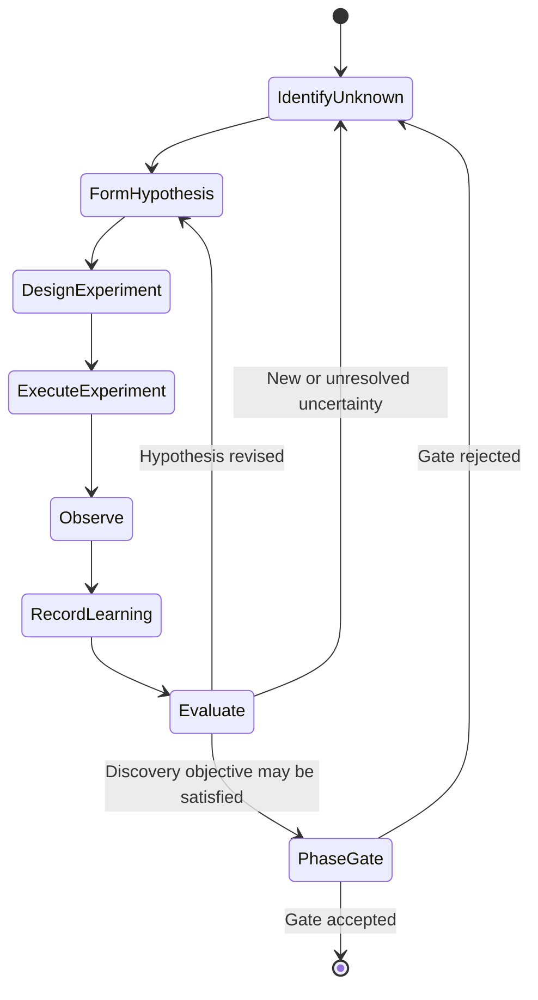
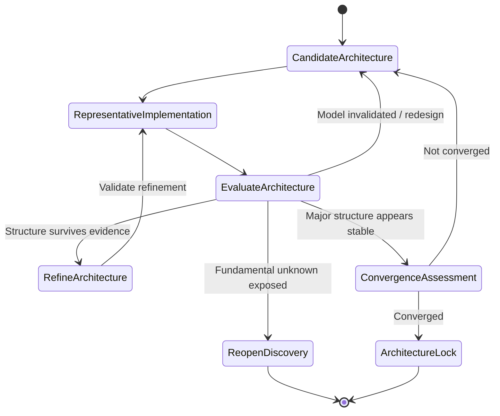
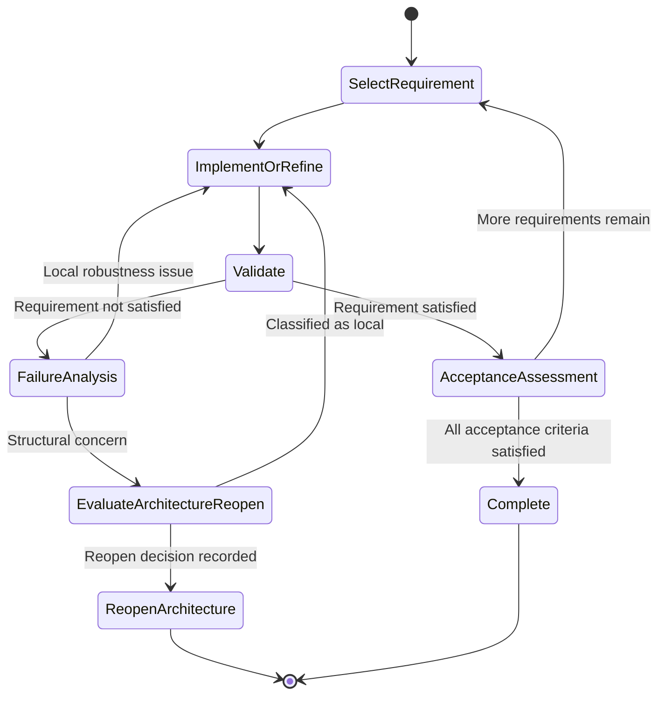

# Iterative AI Development Constitution

## 1. Purpose

The default coding harnesses in Codex, Claude, Antigravity, etc use a relatively generic, output-biased approach. Therefore, they do not implement an SDLC process/philosophy customized to the project or tastes of the host organization.

This constitution overrides the default SDLC behaviors of the harness in favor of a specific and opinionated approach.

This constitution is heavily influenced by [A Pattern Language for Building Software with AI](https://github.com/apinstein/pattern-language-building-with-ai).

Based on the empirical observation that it often takes several major iterations to arrive at a good design for a particular problem, this constitution optimizes for this approach. Each governed change follows a three-phase process:

1. Learning & Exploration
2. System Design & Architecture
3. Hardening, Optimization & Delivery

AI makes implementation cheap enough that early code should often be treated as an experiment rather than an asset. We therefore do not assume that the first plausible design should become the production design.

The governing principle is:

> **Early progress is measured by what we learn. Later progress is measured by what we can reliably ship.**

Code, plans, prototypes, and architecture are instruments for acquiring knowledge until the design has earned stability.

---

## 2. Core Principles

### 2.1 Learning precedes commitment
When important uncertainty remains, prefer experiments that expose reality over additional speculation.

A prototype that invalidates an assumption is successful even if none of its code survives.

### 2.2 Rewrites are expected
Early implementations are disposable by default. Do not preserve an architecture merely because code already exists.

When new evidence undermines the current design, prefer a clean redesign over accumulating patches around a bad abstraction.

### 2.3 Phase determines behavior
Every significant change goes through explicit phases. The phase tells agents what kind of work is appropriate and, equally importantly, what work is premature.

Different changes within the same project may be in different phases.

### 2.4 Evidence beats plausibility
Reasoning, reviews, and adversarial analysis are useful, but they cannot fully substitute for building and interacting with the system.

When inexpensive empirical evidence is available, acquire it.

### 2.5 Knowledge is a first-class artifact
The project must preserve not only what was built, but also:

- what was tried;
- what was learned;
- what failed and why;
- which assumptions were invalidated;
- which decisions were made and on what evidence;
- which acceptance assertions and approvals were made, for what scope and version;
- which uncertainties remain.

### 2.6 Do not confuse activity with progress
More code, tests, documentation, or completed tasks do not necessarily mean the design is converging.

During exploratory phases, the primary measure of progress is **meaningful reduction of uncertainty**.

### 2.7 Avoid premature robustness
Do not heavily optimize, generalize, polish, or build exhaustive test infrastructure around a design that may still be discarded.

Testing during early phases should primarily support experiments and protect conclusions. Production-grade testing belongs after architectural convergence.

### 2.8 Context degradation is expected
Long-running AI agents tend to drift toward local completion, minimal patches, and shipping behavior as context grows.

The process must therefore make current phase, state, constraints, unresolved questions, and exit criteria easy to recover from durable artifacts rather than conversational history.

### 2.9 Organize work via opinionated VCS (git) structure
AI needs cheap, isolated places to learn as well as a protected line of code that is intended to eventually merge into the base. Each significant change therefore has one durable integration branch and may create short-lived work branches whose intent is declared before work begins.

This is implemented through three active branch roles and one retained archive namespace within `codex/<change>/`:

* A single **integration** branch for the change
* Any number of **spike** branches; a **spike** branch is intentionally a dead-end and not expected to be merged
* Any number of **merge** branches; a **merge** branch may eventually reach the change's integration branch, directly or through a stacked merge
* An **archive** namespace for closed spike branches and rejected merge branches, retained until the change completes

This lets the project run as many experiments as necessary without allowing exploratory code or a growing Git graph to dictate the shape of the converging system.

### 2.10 Spikes expand around an uncertainty

A spike bounds an uncertainty, not an immutable task list. A human or agent may
expand its scope when new evidence reveals a directly connected question that
can be answered more cheaply in the same experiment. Update the phase plan and
branch manifest when the question, evidence, or exit criteria materially
change. Create a separate spike only when the uncertainty is independent or the
branch intent changes.

### 2.11 Humans control spike disposition

Agents may collect evidence, commit checkpoints, and recommend a disposition.
They must not infer permission to archive a spike from a passing test, accepted
UAT, a completed checklist, or a proposed phase transition. A human explicitly
decides whether a reviewed spike continues, changes scope, is archived, or
supplies evidence for a phase gate.

---

## 3. Unit of Work: The Change

A **change** is any feature, subsystem, architectural modification, or sufficiently complex problem that deserves an independent learning cycle.

A change is not defined by the current working branch. Work requested within an active, named change follows that change's current state and does not initialize another change. A request outside an active change must first be qualified:

- **Routine local work** may follow the project's ordinary workflow without creating a governed change.
- **A significant, independent change** initializes this constitution's workspace, integration manifest, and branch structure before implementation begins.

#### Scope after Architecture Lock

Architecture Lock does not give an agent standing permission to silently absorb
new development requests. When an active locked change receives a request that
is not in its current plan, the agent must identify the existing boundary or
contract through which the request would fit, then ask the responsible human
whether to amend the current change's Delivery scope or track the request
separately.

If the human authorizes the amendment, record the added use case, acceptance
criteria, affected boundaries, and required regression or operational evidence
in the Delivery plan, `DECISIONS.md`, and a change-level Acceptance Ledger
entry. The amendment may proceed in Delivery only while it remains within the
locked architecture's declared envelope. Evidence that it requires a material
new boundary, invalidates a locked assumption, or exposes a fundamental unknown
requires an explicit Architecture reopen decision. An independent outcome is a
new change.

`Complete` is terminal. A change reaches it only after its integration branch
has merged into the declared base and that final integration has been verified.
Agents must not reopen or extend a completed change. A later request is
qualified as new work and may cite the completed change's architecture and
evidence, but receives its own scope, acceptance criteria, and integration
path.

Each significant change receives a durable workspace, for example:

```text
changes/
  <change-name>/
    STATE.md
    ACCEPTANCE_LEDGER.md
    VCS/
      INDEX.md
      integration.md
    1-discovery/
      STATE.md
      PLAN.md
      LEARNINGS.md
      DECISIONS.md
      ACCEPTANCE_LEDGER.md
      VCS/
        spike-http-semantics-01.md
    2-architecture/
      STATE.md
      PLAN.md
      LEARNINGS.md
      DECISIONS.md
      ACCEPTANCE_LEDGER.md
      VCS/
        spike-auth-contract-01.md
        merge-retry-boundary-01.md
    3-delivery/
      STATE.md
      PLAN.md
      LEARNINGS.md
      DECISIONS.md
      ACCEPTANCE_LEDGER.md
      VCS/
        spike-release-upgrade-01.md
        merge-backoff-limit-01.md
```

The exact filenames are conventional rather than sacred. The semantic roles are required.

### 3.1 Git branch contract

When a change is initialized, create its durable integration branch from its chosen base branch:

```text
codex/<change>/integration
```

The integration branch is the isolated home for the whole change. It remains separate from its base until the change is ready for its final integration.

#### Base synchronization

If the change needs updates from its base branch, merge the current base branch into the integration branch and resolve and validate the result there. Do not rebase or otherwise rewrite the integration branch as the ordinary synchronization mechanism. A more sophisticated compatibility, dependency, or future-change integration strategy requires an explicit, recorded override in `DECISIONS.md`.

#### Checkpoint commits

Commit each **coherent, verified slice** of work as soon as it is ready. A
slice may include the implementation, focused regression coverage, and the
documentation or state needed to explain that one result. It is not every
small edit: keep closely related changes together and avoid manufacturing
micro-commits that are hard to review, test, revert, or understand.

In particular, after a repair has passed its focused and relevant regression
tests, commit that repair before beginning or accumulating unrelated work.
This creates a recoverable checkpoint with evidence while keeping unrelated
changes out of the same commit. If the slice cannot yet be verified, keep its
scope explicit and return to verification before treating it as a checkpoint.

A change is expected to create numerous work branches as it moves through its phases. Whenever an agent identifies a bounded implementation or an uncertainty that is cheaper to investigate in isolation, it may create the permitted merge or spike branch for the current phase. Every branch creation must follow the manifest and index contract below.

Active work branches are named by their declared intent:

```text
codex/<change>/spike/<name>
codex/<change>/merge/<name>
```

Closed work branches that remain useful for reference are retained in the archive namespace:

```text
codex/<change>/archive/spike/<name>
codex/<change>/archive/merge/<name>
```

The branch name answers what kind of work it is. The manifest answers what is true about that particular branch.

Branch names deliberately omit phase. Phase is lifecycle context that can advance or reopen; branch intent is immutable. The manifest records the phase, and its phase-local `VCS/` directory makes that context discoverable without encoding it twice in the Git ref.

Work branches are **phase-bound**. A phase transition never carries an active
branch into the next phase: before the change-level state enters the incoming
phase, every work branch created in the outgoing phase must receive its final
disposition. A human-authorized spike is archived after its findings are
recorded; a merge branch is merged toward integration or rejected and archived.
If follow-on work is appropriate in the incoming phase, create a new branch
with the incoming phase's permitted intent, using the resolved prior branch
only as evidence. In particular, a Phase 1 spike cannot become Phase 2 work,
and a Phase 2 merge branch cannot become Phase 3 work.

#### Branch creation

Branch creation is a manifest transaction. When initializing a change, create `VCS/integration.md` and `VCS/INDEX.md` in the integration branch's first commit. Whenever an agent creates a work branch, it must first create that branch's manifest—recording its intended base branch and base commit—and update `VCS/INDEX.md` in a direct control-plane commit on the integration branch, then create the work branch from that declared base commit. The integration branch's version of these control-plane artifacts is authoritative even when an active work branch does not contain the latest control-plane commit. No implementation work may begin on a branch without its manifest and an index entry.

Here, *transaction* means one logical, resumable operation; it does not require Git to make all metadata and ref mutations atomically. If creation or closure is interrupted, or concurrent metadata updates conflict, reconcile the manifests and rebuild `VCS/INDEX.md` before implementation continues.

Agents update canonical manifests, index entries, state files, Acceptance Ledgers, and phase artifacts through the integration branch (using a dedicated integration worktree or a brief checkout when necessary). They do not merge a spike merely to transfer control-plane metadata.

A `spike` branch may use the integration branch or another active work branch as its base. A `merge` branch may use the integration branch or another active `merge` branch as its base. A `merge` branch must never use a `spike` as its base, so code intended to converge cannot terminate on a reference-only branch. The manifest makes any permitted recursive dependency explicit rather than inferring it from naming or conversation.

#### Worktrees

Branches and their manifests define repository state; worktrees are optional local execution isolation. An agent may create a dedicated worktree when it needs to work on an active branch alongside another checkout, including for parallel work. Creating or removing a worktree neither creates nor closes a branch and does not change the manifest or index.

#### VCS manifests

The integration branch has `VCS/integration.md`. Each work branch has one concise, flat manifest in the `VCS/` directory of the phase in which it was created, named `<intent>-<name>.md`. For example, `codex/payment-retry/spike/http-semantics-01` has `1-discovery/VCS/spike-http-semantics-01.md`. A name must be unique within its change; use a suffix such as `-02` for a distinct follow-up.

Each manifest records only the branch contract and its outcome, not a duplicate plan or learning history:

```markdown
Branch: codex/payment-retry/spike/http-semantics-01
Base branch: codex/payment-retry/integration
Base commit: <full commit SHA>
Phase: 1 — Learning & Exploration
Intent: spike
Expected disposition: reference-only
Status: active
Purpose: establish retry behavior for HTTP 429 and 503
Exit evidence: reproducible observations and a recorded conclusion
Closure: pending
Acceptance ledger references: none
```

The integration manifest records its base branch and ref. A work-branch manifest records the actual branch and commit from which it begins; a spike may base on another active work branch, while a merge branch may base only on integration or another active merge branch. Together these records make the topology discoverable without requiring a separate hand-maintained graph.

#### VCS index

`VCS/INDEX.md` is the live shortcut to the change's branch state. It links to the integration manifest and every work-branch manifest, grouped by phase and status so an agent can quickly identify active, merged, archived, and rejected branches while re-establishing context.

Update the index as part of the same branch-creation or branch-closure transaction whenever a branch is created, merged, or archived. The manifests are authoritative; the index is a rebuildable materialized view. If its state is missing, stale, or inconsistent, rebuild it by reading `VCS/integration.md` and all `*/VCS/*.md` files, then regenerate the grouped links and statuses before continuing work.

#### Branch topology explanations

Whenever an agent explains branch topology in conversation or documentation,
use a plain-text, indented `+->` tree in a `text` code block rooted at `main`.
Include the ancestors needed to connect the relevant branches to `main`.
This is a presentation of repository evidence, not a separate authoritative
graph or permission to create dependencies.

- Every branch line must show the exact Git branch name and its local tip
  commit SHA, verified from the repository when preparing a live report.
  Use `[Constitutional change: <canonical change name>]` for each change's
  integration branch, taking the name from its canonical change artifacts.
  Distinguish work branches with `[Merge branch]` or `[Spike branch]`, and
  ordinary branches outside the constitutional workflow with `[Regular branch]`.
  A human-readable label alone is insufficient.
- Mark the current checkout with `← current checkout` on its branch line.
  If HEAD is detached or the checkout lies outside the displayed scope, state
  that explicitly below the tree rather than marking another branch.
- Under each non-root branch, put its explicit fork commit or manifest-declared
  base branch and commit on a separate, further-indented line when available.
  Distinguish a verified historical fork from a declared base; do not present
  a computed merge base as proof of the original fork. If a local ref, canonical
  name, or base cannot be verified, mark it unavailable or unknown rather than
  inventing a name or SHA.
- Indent children beneath their actual fork or declared base branch. Show
  sibling branches at the same indentation under their common parent; do not
  turn siblings into a dependency chain. If landing order matters, add one
  short line below the tree spelling it out.

Reusable, project-neutral example (the stacked changes' declared bases and any
required dependency override are assumed recorded; replace SHA placeholders
with verified commits in a live report):

```text
main @ <main tip SHA>
+-> [Constitutional change: Shared foundation] codex/shared-foundation/integration @ <tip SHA>
    declared base: main @ <base SHA>
    +-> [Constitutional change: Import workflow] codex/import-workflow/integration @ <tip SHA>
        declared base: codex/shared-foundation/integration @ <base SHA>
        +-> [Constitutional change: Saved records] codex/saved-records/integration @ <tip SHA>
            declared base: codex/import-workflow/integration @ <base SHA>
            +-> [Merge branch] codex/saved-records/merge/updater-01 @ <tip SHA> ← current checkout
                declared base: codex/saved-records/integration @ <base SHA>
+-> [Regular branch] codex/docs-cleanup @ <tip SHA>
    forked from main at <fork SHA>
```

Landing order after required approvals: updater-01 → Saved records → Import workflow → Shared foundation → main; docs-cleanup lands independently.

The tree does not change branch intent, phase restrictions, merge approvals,
base synchronization, or closure rules. In particular, spikes remain
reference-only and parallel active leaves still require an explicit decision.

#### Phase and branch intent

Phase determines the kind of progress being pursued. Branch intent determines whether the branch's code may enter integration. They are separate dimensions:

| Phase | Allowed work-branch intents | Default behavior |
| --- | --- | --- |
| 1 — Learning & Exploration | `spike` | All work-branch code is reference-only. The integration line receives durable phase artifacts, especially learnings and decisions, not exploratory implementations. |
| 2 — System Design & Architecture | `spike`, `merge` | Use spikes to resolve local uncertainty and merge branches to advance the selected architecture. |
| 3 — Hardening, Optimization & Delivery | `spike`, `merge` | Merge branches are normal. Spikes are permitted only for narrow empirical questions. A suspected structural flaw requires a recorded classification decision; a decision to reopen uses a fresh Phase 2 merge branch. |

#### Branch intents and closure

Every work branch has exactly one immutable intent:

| Intent | Purpose | Allowed closure(s) |
| --- | --- | --- |
| `spike` | Learn, probe, compare, or falsify. Its code is reference-only. | Move to `ready_for_human_review` after its evidence checkpoint; archive only after explicit human authorization. |
| `merge` | Implement a bounded slice intended to reach integration directly or through a stacked merge. | Merge after it has been successfully merged into its declared base, or archive as "explicitly unmerged" with the reason it was not adopted. |

`integration` is a durable branch role, not a work-branch intent. It accepts new change implementation code only through deliberately promoted merge branches; it may also receive its declared base branch through the Base synchronization policy and contain direct control-plane commits for constitution metadata, manifests, indexes, state, learnings, decisions, and other documentation artifacts. It is finally merged into its base when the change completes.

Branch intent does not change. A spike that uncovers a sound implementation still closes as a spike; a new merge work branch begins from integration or an active merge branch and uses the spike as evidence. This preserves a clean boundary between experimental code and code intended to converge.

#### Spike review lifecycle

`ready_for_human_review` is a nonterminal **manifest status**, not a node in
the Discovery, Architecture, or Delivery state machines:

```text
active -> ready_for_human_review -> archived
  ^                |
  +----------------+
   human: continue or rescope
```

An agent may make the first transition only after it creates the required
evidence checkpoint. The human may return the spike to `active` to continue or
rescope it, authorize archival, or approve a phase gate. A human phase-gate
approval does not promote spike code: the spike is archived as reference-only,
and the incoming phase begins a new allowed branch from integration.

The work-branch manifest begins with `Status: active`. A spike may become
`ready_for_human_review`; its terminal status is `archived` when it is retained
for reference. A merge branch's terminal status is `merged` when it has
successfully reached its declared base or `rejected` when explicitly abandoned.
A closure record includes the resulting base commit or archive branch and
pointers to the relevant phase `LEARNINGS.md`, `DECISIONS.md`, and Acceptance
Ledger entries. A merge branch may become `rejected` only after its abandonment decision and
reason are recorded in both its manifest and the phase's `DECISIONS.md`.
`VCS/INDEX.md` needs to record only this immediate disposition; collapsing a
completed merge stack into integration is not a closure requirement.

Merge-stack closure is topologically ordered. An active merge branch may not be merged or rejected while it has active merge descendants. Each descendant must first merge into its declared base or be rejected and archived. If a parent merge branch is rejected, reject and archive any remaining merge descendants from the leaves upward; no descendant may bypass its declared base to reach integration.

#### Spike evidence checkpoint and archive closure

Before an agent may mark a spike `ready_for_human_review`, it must:

1. commit the spike's experimental code, tests, fixtures, and local notes, and
   verify that its worktree is clean;
2. update the integration branch's current control-plane artifacts with the
   salient findings, consequential decisions, manifest status, and handoff;
3. record the evidence commit(s), relevant tests, and applicable Acceptance
   Ledger entry IDs in the manifest; and
4. recommend, but not perform, a branch disposition.

Archiving is a rename into the change's archive namespace, not deletion or an
untracked dead end. To archive a spike after explicit human authorization:

1. verify the evidence checkpoint and record the explicit human authorization
   in the applicable Acceptance Ledger;
2. rename its ref to `codex/<change>/archive/<intent>/<name>`;
3. update its manifest and `VCS/INDEX.md` with `Status: archived`, the archive
   branch name, the human disposition, and pointers to the phase artifacts;
4. verify that the integration artifacts, closure record, and archive branch
   exist; when a shared remote is used, push and verify all three there. Push
   and verify the archive branch before deleting the active remote branch;

The archive branch preserves the exact experimental code and change set for later forensic reference. The integration workspace preserves the durable conclusion. No code from an archived spike is merged. If the canonical phase artifacts or archive branch cannot be verified, leave the archive branch and any dedicated worktree in place.

Rejected merge branches use the same rename and verification mechanics, but
retain `Status: rejected` and their recorded abandonment decision. The spike
human-disposition requirement does not replace the merge rejection rules.

#### Merge closure

Before merging a merge branch, record the required merge approval in the
applicable Acceptance Ledger. The approval must identify evidence that every
repaired or changed boundary has focused regression coverage and that the full
relevant suite selected from the branch's impact is passing at the submitted
commit. "Relevant" is determined by the declared affected contracts,
integration seams, and blast radius; it is not a license to omit a known
affected suite, nor a demand for the exhaustive Phase 3 delivery matrix.

This is a merge-readiness gate for every branch intended to reach integration,
including a Phase 2 branch. It establishes that the bounded slice is safe to
integrate; it does not by itself establish that the whole change is delivery
ready. If/when the branch is successfully merged into its declared base, update
its manifest and `VCS/INDEX.md` to `Status: merged` with the resulting base
commit, and verify the result.

If/when a merge branch is explicitly abandoned rather than adopted, do not
merge it. Record the abandonment decision and reason in `DECISIONS.md` and the
applicable Acceptance Ledger, then close it through the archive procedure with
`Status: rejected`.

#### Change cleanup

After the integration branch is merged into its base and the change is complete, verify that the base contains the canonical phase artifacts and Acceptance Ledgers and that `VCS/INDEX.md` has no active work branches. Then remove any remaining dedicated worktrees for the change and delete every local and remote `codex/<change>/...` ref, including the integration and archive branches. The durable record is now the merged integration history and its artifacts in the base; raw exploratory code is intentionally eligible for cleanup.

By default, a change has one active path: the integration branch and, if nested work is necessary, a single chain of work branches. Parallel active leaves require an explicit decision, and integration may not merge into its base while any work branches remain unresolved.

---

## 4. Phase Model

The process has three major phases. A phase may contain **multiple iterations**. Phase transitions are earned by evidence, not iteration count. The human-facing phase titles are used throughout this constitution; the operational labels are **Discovery**, **Architecture**, and **Delivery**.

### Phase 1 — Learning & Exploration

**Objective:** understand the problem and eliminate important unknowns cheaply.

Typical work includes:

- identifying assumptions and unknowns;
- building narrow proofs of concept;
- probing APIs, libraries, data, interfaces, performance characteristics, and user interactions;
- testing how components behave individually;
- testing risky integration seams;
- comparing multiple approaches;
- deliberately attempting to falsify promising designs.

Production architecture is not the goal.

Code written here should normally be assumed disposable.

#### Phase 1 exit condition

Advance only when the important unknowns that would prevent meaningful architectural design have either:

1. been answered with evidence; or
2. been explicitly accepted as residual risks.

If the team still cannot explain the important constraints and failure modes of the problem, remain in Phase 1.

---

### Phase 2 — System Design & Architecture

**Objective:** converge on and implement a system structure that survives contact with implementation.

Using Phase 1 evidence, design the system as if starting fresh. Do not automatically evolve the proof-of-concept architecture.

Typical work includes:

- generating and comparing candidate architectures;
- defining boundaries, responsibilities, interfaces, and data flows;
- implementing the selected architecture far enough to expose hidden coupling and incorrect abstractions;
- exercising representative end-to-end paths and the scoped acceptance path;
- repairing boundaries with focused regression coverage and integrating verified architectural slices;
- revisiting decisions when implementation produces contradictory evidence;
- rewriting substantial portions when warranted.

Multiple architectural iterations are expected.

The goal is **convergence**, not merely a functioning implementation. Phase 2
is not diagram-only design followed by default implementation in Phase 3: it
may contain all implementation and validation needed to satisfy the change's
scoped acceptance criteria.

#### Architectural convergence

Architecture is converging when successive iterations primarily produce refinements rather than replacements.

Signals include:

- major component boundaries remain stable;
- new requirements fit without unnatural workarounds;
- implementation repeatedly validates rather than overturns the model;
- major unknowns have become localized engineering questions;
- remaining changes increasingly concern robustness, ergonomics, performance, and completeness.

#### Phase 2 exit condition: Architecture Lock

Architecture may be locked when the evidence indicates that another broad redesign is unlikely to produce enough benefit to justify its cost.

Architecture Lock is a deliberate decision, recorded in `DECISIONS.md` and reflected in `STATE.md`.

Lock does **not** mean architecture can never change. It means architectural changes now require explicit justification rather than being the default mode of iteration.

Architecture Lock selects the next lifecycle outcome; it does not automatically
require Delivery:

1. advance directly to `Complete` when the scoped acceptance criteria are
   verified and approved; or
2. advance to **Delivery** — Phase 3, the optional post-lock phase for
   completing remaining work through the locked architecture — when the
   existing scope still requires hardening, operationalization, compatibility
   work, performance, security, polish, or another delivery commitment.

Phase 3 work must remain within the active change's scope unless the human
explicitly authorizes an aligned scope amendment under
[Scope after Architecture Lock](#scope-after-architecture-lock).

---

### Phase 3 — Hardening, Optimization & Delivery

**Objective:** complete the remaining hardening and delivery commitments within a converged design's original or explicitly amended scope.

Only now should the project aggressively invest in assets whose value depends on architectural stability.

Typical work includes:

- comprehensive test matrices;
- edge-case handling;
- reliability and failure recovery;
- observability;
- security hardening;
- performance optimization;
- maintainability and refactoring;
- compatibility and migration behavior;
- operational tooling;
- user-facing polish;
- production documentation.

This optional delivery phase should optimize and extend the locked system
through its existing boundaries rather than continually rediscover its basic
shape. It is appropriate when the original acceptance criteria still require
delivery work or when the responsible human explicitly adds an architecturally
aligned use case to the active change. It is not the default implementation
phase for an architecture that merely became locked. It is typically substantial
when a sophisticated change first needs a stable basic architecture and then
requires significant implementation, use cases, or operational behavior to be
completed through that architecture.

If delivery work suggests a fundamental architectural flaw, preserve and classify the evidence before continuing structural work. If the recorded decision is to reopen Phase 2, close or archive the affected Phase 3 work branch and begin a fresh Phase 2 merge branch; do not repair the structural flaw on the Phase 3 branch.

---

## 5. State Machines

The process is governed by one overall change lifecycle and one operational state machine for each phase.

The overall state machine determines **which mode of work applies**. The phase-specific state machine determines **what kind of action should happen next inside that mode**.

Each phase-level `STATE.md` must identify its current state using the conceptual states below, giving every agent an explicit **you are here** marker.

### 5.1 Overall change lifecycle

```mermaid
stateDiagram-v2
    [*] --> Discovery
    Discovery --> Discovery: Continue learning
    Discovery --> Architecture: Discovery gate satisfied
    Architecture --> Architecture: Continue convergence
    Architecture --> Discovery: Fundamental unknown discovered
    Architecture --> Complete: Lock and scoped acceptance approved; final integration verified
    Architecture --> Delivery: Architecture Lock; delivery work or authorized aligned scope remains
    Delivery --> Delivery: Continue delivery work
    Delivery --> Architecture: Reopen decision recorded
    Delivery --> Complete: Acceptance criteria satisfied; final integration verified
    Complete --> [*]
```



The change-level `STATE.md` records the current node in this lifecycle.
`Complete` has no outgoing transition: a later request is new work, not a
reason to reopen the completed change.

### 5.2 Discovery state machine



Discovery cycles until the important unknowns blocking meaningful architectural design have been answered or explicitly accepted as residual risks.

### 5.3 Architecture state machine



A functioning implementation is not itself evidence of convergence. Architecture remains in this loop until implementation increasingly validates rather than overturns the system model.

### 5.4 Delivery state machine



Delivery failures must be classified before being fixed. A suspected structural flaw enters an explicit reopen evaluation. Local failures remain in Delivery; when the recorded decision is to reopen Architecture, close or archive the affected Delivery work branch and create a fresh Phase 2 merge branch rather than hiding a structural repair beneath a Phase 3 patch.

### 5.5 Work-branch review lifecycle

The manifest lifecycle in [Spike review lifecycle](#spike-review-lifecycle)
controls human review and closure of a spike. It deliberately does not alter an
active phase's state-machine node. A phase transition still follows the overall
change lifecycle and its normal control-plane transaction.

### 5.6 State-machine discipline

State machines are operational constraints, not decorative diagrams. Agents must identify both the current change-level phase and the current phase-level state before working, perform work appropriate to that state, and update the relevant state file whenever evidence causes a transition.

Agents must use explicit backward transitions when evidence invalidates assumptions from an earlier state or phase. They must not silently jump ahead because a later activity is easier to execute or appears closer to shipping.

---

## 6. Required Artifacts

### 6.1 `STATE.md` — Current operational truth

State exists at **two levels**: the change and the active phase.

Plans describe intended approach. State describes what is actually true **right now**. State files should be deliberately short, frequently updated, and optimized for agent resumption. They are not histories; durable history belongs in `LEARNINGS.md` and `DECISIONS.md`.

#### Change-level `STATE.md`

The change-level state file is the first change-specific document an agent should read. It acts as the router for the entire change.

```markdown
# Change State

Phase: 2 — System Design & Architecture
Phase State: EvaluateArchitecture
Architecture Lock: No
Status: Active

## Current top-level objective
...

## Active phase
- `2-architecture/STATE.md`

## Global blockers
- ...

## Cross-phase unresolved questions
- ...

## Current phase gate
...

## Next top-level actions
- [ ] ...

## Relevant artifacts
- ...

## Last meaningful transition
...
```

It answers:

> **Where is this change in its overall lifecycle, and where should an agent go next?**

It should not duplicate all operational detail from the phase-level state file.

#### Phase-level `STATE.md`

Every phase directory has its own `STATE.md`. It records live operational state **inside that phase** and corresponds directly to a node in that phase's Mermaid state machine.

```markdown
# Architecture State

State: EvaluateArchitecture
Iteration: 3
Status: Active

## Current objective
...

## Current hypothesis / approach
...

## Active questions
- ...

## Current work
...

## Evidence being evaluated
- ...

## Known blockers
- ...

## Next actions
- [ ] ...

## Phase exit criteria status
- [ ] ...
- [x] ...

## Relevant artifacts
- ...

## Last meaningful learning
...
```

The exact fields may vary by phase, but every phase state file must make clear the current state-machine node, current iteration or experiment where relevant, immediate objective, active questions, current work, next actions, blockers, phase-exit status, and pointers to relevant artifacts.

It answers:

> **What exactly are we doing now, why are we doing it, and what transition are we trying to earn?**

When a phase becomes inactive, its final state remains as a historical snapshot unless that phase is explicitly reopened.

#### State synchronization

The change-level and phase-level state files must agree. A phase transition is a control-plane transaction, not a sequence of independently visible state edits.

Once the phase gate is accepted, complete the following Git hygiene before switching the change-level state:

1. give every active work branch in the outgoing phase its required final disposition and update its manifest and `VCS/INDEX.md`;
2. record durable conclusions and gate evidence in `LEARNINGS.md` and `DECISIONS.md`, append the phase-level acceptance record, and append the change-level phase-gate authority record that references it;
3. prepare or reactivate the incoming phase `STATE.md` with `Status: Pending activation` and its initial state-machine node;
4. make one direct control-plane commit on the integration branch that marks the outgoing phase state inactive at its terminal node, marks the incoming phase state active, and updates the change-level `STATE.md` with the new phase, phase state, and active-phase pointer.

Until the transition commit exists, the prior committed change-level state remains authoritative. If preparation is interrupted, reconcile the recorded branch dispositions and gate evidence, then retry the transition transaction; do not point the change-level state at an inactive or uninitialized phase.

#### Direct completion from Architecture

An Architecture-to-Complete transition is a completion transaction, not a
silent omission of Delivery. Before final integration, close every active
Architecture work branch, record the Architecture Lock evidence and the
verified scoped acceptance criteria in the phase Acceptance Ledger, and append
a change-level Acceptance Ledger entry that grants change-completion authority.
Make one direct control-plane commit on integration that leaves Architecture at
the terminal `ArchitectureLock` state and marks the change as ready for final
integration; no Delivery phase state is created. Merge integration into its
declared base and verify that the base contains the canonical artifacts and
completion evidence. Only then record the change-level state as `Complete` in
the base's canonical control-plane history and begin cleanup. The completion
state is authoritative only after the final integration succeeds.

This direct path is typical for a refactor of an existing capability: the
architecture is established by preserving or improving the existing behavior,
and the scoped regressions and relevant suites establish completion without a
separate delivery phase.

The repository may additionally maintain a project-level state file summarizing all active changes and their phases.

---

### 6.2 `PLAN.md` — Intent and evaluation

A plan must state:

- the problem being addressed;
- the current objective;
- important assumptions;
- known unknowns;
- proposed experiments or implementation work;
- expected observations;
- acceptance or exit criteria;
- explicit non-goals appropriate to the current phase.

Plans should answer not merely **what will we build?**, but **what are we trying to learn or establish?**

Every phase plan must contain explicit, observable phase exit criteria. A work
branch's `Purpose` and `Exit evidence` are its branch-specific exit criteria and
must be consistent with the current phase plan. Before accepting a phase gate,
merging a merge branch, or declaring a change complete, verify the relevant
criteria and have the result approved by a human and/or a clean-room AI
adjudicator that did not materially perform the evaluated work. Record the
rationale, evidence, and adjudicator in `DECISIONS.md`; record the canonical
approval in the applicable Acceptance Ledger; and include the relevant pointer
in the branch closure record when applicable.

Record these approvals as separate Acceptance Ledger types whenever applicable:

- **Human UAT** answers whether the observed product behavior is acceptable.
- **Human branch disposition** authorizes a spike to continue, rescope, or
  archive.
- **Human phase-gate approval** authorizes the change to advance phases.
- **Human scope-amendment authorization** adds an architecturally aligned use
  case to an active locked change's Delivery scope.
- **Human completion authority** authorizes the terminal completion transaction
  after its acceptance criteria have been verified.

One ledger entry does not imply another. In particular, a Human UAT entry does
not imply branch-disposition or phase-gate authority.

---

### 6.3 `LEARNINGS.md` — Empirical memory

Record durable discoveries, especially surprising ones.

Each significant learning should ideally capture:

```markdown
## Learning

Observation:

Evidence:

Previous assumption:

Updated understanding:

Implication:

Confidence:
```

Failed approaches belong here when the failure teaches something likely to matter later.

Do not repeatedly rediscover known failures.

---

### 6.4 `DECISIONS.md` — Decision record

Record consequential decisions and their rationale.

```markdown
## Decision

Decision:

Context:

Alternatives considered:

Evidence:

Why this choice:

Confidence:

What would cause us to reconsider:
```

A decision without reconsideration criteria risks becoming dogma.

### 6.5 `ACCEPTANCE_LEDGER.md` — Append-only authority record

An Acceptance Ledger records an assertion that a bounded subject has been
accepted, rejected, accepted with exceptions, or superseded. It answers a
different question from the other durable artifacts:

- `LEARNINGS.md` records what was discovered.
- `DECISIONS.md` records why a choice was made.
- `ACCEPTANCE_LEDGER.md` records **who accepted what, for which exact scope or
  version, on what evidence, and with what authority**.

Every change has a change-level `ACCEPTANCE_LEDGER.md`; every phase has its own
phase-level `ACCEPTANCE_LEDGER.md`. The phase ledger is the canonical record
for phase-local acceptance, such as an experiment conclusion, accepted
residual risk, architecture-boundary approval, or a bounded subset of UAT. The
change-level ledger is the canonical record for change-wide authority, such as
a phase-gate approval, full-version or cross-phase UAT, final change
acceptance, a scope amendment, or a cross-phase residual-risk acceptance.

Record each acceptance event in the narrowest applicable ledger. When a
phase-local acceptance supports a change-wide action, record a distinct
change-level authority event that references the phase entry; do not copy the
same evidence into both ledgers. A manifest or state file may summarize the
current result, but it must reference ledger entry IDs. The latest relevant
non-superseded entry for the same subject, version, and authority determines
that result.

The ledger is append-only. Never edit, delete, or silently replace a committed
entry. Correct an error, revoke an acceptance, or record a later result by
appending a new entry that identifies the entry it supersedes.

An agent must append an assertion entry before it represents UAT or another
acceptance as complete. When an agent receives such an assertion from a human,
it records the reported assertion in the applicable ledger before relying on
it. An AI assertion is a claim, not human acceptance, unless an authorized
human or clean-room AI adjudicator separately records its approval.

Each entry must include enough information to reproduce the scope and
authority of the assertion:

```markdown
## ACC-<change>-<scope>-0007 — 2026-08-11T14:32:00Z

Scope: change | phase | named subset
Type: evidence | UAT | residual risk | architecture | scope amendment | branch disposition | phase gate | delivery | completion
Subject: <feature, experiment, requirement, or named subset>
Version under test: <commit SHA, build/version, environment, or N/A>
Criteria and evidence: <artifact paths, entry IDs, test runs, and observations>
Assertion: <what is asserted>
Asserted by: <human or agent identity>
Adjudicated or approved by: <human, clean-room AI, or pending>
Result: asserted | accepted | rejected | accepted with exceptions | superseded
Authority granted: none | branch disposition | phase transition | scope amendment | change completion
Supersedes: <Acceptance ID or none>
```

An Acceptance ID must be unique within the change. The `<scope>` component is
`change` for the change-level ledger or the phase directory name for a
phase-level ledger.

For UAT, `Version under test` must identify an immutable commit or build and
its relevant environment; it must never say only “current” or “latest.” A
partial UAT entry must identify the exact accepted subset and any remaining
coverage. UAT is an acceptance type, not special authority: it does not grant
branch closure, phase transition, or change completion unless the recorded
entry explicitly grants that authority and the constitution's separate rules
for that action are met.

### 6.6 Discovery-to-Architecture handoff

Before proposing a Discovery phase gate, `LEARNINGS.md` must contain a
`Forward to Architecture` section with:

```markdown
### Proven boundaries
### Decisions to preserve
### Residual risks accepted
### Open architecture choices
### Evidence and fixtures to carry forward
### Architecture acceptance checks
### What is intentionally reference-only
```

Prepare the incoming Architecture plan, state, learnings, decisions, and
Acceptance Ledger from this handoff before the phase-transition control-plane
commit. They must not remain generic placeholders after the gate is proposed.

---

## 7. Uncertainty Discipline

Every phase should maintain an explicit model of uncertainty.

Useful categories include:

- **Known:** supported by adequate evidence.
- **Hypothesized:** plausible but not adequately tested.
- **Unknown:** recognized gap in understanding.
- **Assumed:** deliberately accepted without current validation.

Agents should preferentially attack uncertainties that combine:

1. high architectural impact;
2. high probability of being wrong; and
3. low cost of obtaining evidence.

When deciding what to do next, ask:

> **What is the cheapest action that could materially change our understanding or design?**

When a spike expands around a connected uncertainty, record the scope amendment
in its plan and manifest before treating the new question as an exit criterion.
This preserves the useful flexibility of exploration without letting a stale
plan or checklist silently govern the branch.

---

## 8. Phase Gates

Phase transitions and completion transitions are explicit decisions, not
passive drift.

Before advancing or completing, an agent must evaluate the relevant exit
criteria and record the result in the outgoing phase's Acceptance Ledger. A
change-level phase-gate or change-completion entry must then reference that
evidence and record the authority to advance or complete.

A useful gate review asks:

- What important questions did this phase need to answer?
- What evidence answers them?
- What remains unknown?
- Which assumptions remain untested?
- What evidence would cause us to reverse the proposed transition?
- Are we advancing because uncertainty has fallen, or because we are tired of exploring?

If the evidence does not support transition, remain in the phase.

An agent may recommend a spike disposition only after the spike evidence
checkpoint is committed. An agent may recommend a phase gate or direct
completion only after the required phase evidence is committed. The human
records branch disposition, phase-gate approval, and completion authority as
separate Acceptance Ledger entries; accepted UAT alone is not closure authority.

---

## 9. Agent Operating Rules

### 9.1 Adoption and precedence

An organization adopts this constitution by directing its agents to follow it for a named scope of changes. The adoption instruction must identify this document and the governed scope. Within that scope, this constitution governs SDLC and VCS behavior unless a more-local project rule explicitly overrides it.

For example, place this sentence in the project's agent rules or bootstrap file:

> Adopt `iterative-design-constitution/ITERATIVE_AI_DEVELOPMENT_CONSTITUTION.md` for each named change in this project. Treat it as the governing SDLC and VCS process unless a more-local project rule explicitly overrides it.

### 9.2 Startup sequence

Every agent working on a governed change should follow this startup sequence:

1. Read this constitution.
2. Read the project's current state.
3. Read the change-level `STATE.md`.
4. Follow its pointer to the active phase and read that phase's `STATE.md`.
5. Confirm the current state-machine node and available transitions.
6. Read `VCS/INDEX.md`, `VCS/integration.md`, and the manifest for the current branch, if any.
7. Read the change-level Acceptance Ledger, the active phase's Acceptance Ledger, and any entries referenced by the current manifest or state.
8. Read the current phase `PLAN.md`.
9. Read relevant learnings and decisions.
10. Inspect the relevant code.
11. Confirm that the intended action is appropriate for the current phase, phase state, branch intent, and current acceptance records.
12. Work.
13. Update state files whenever meaningful operational state changes.
14. Update durable learnings, decisions, and acceptance records whenever the state of knowledge or authority changes.

### Agents MUST NOT

- optimize for task completion at the expense of the current phase objective;
- silently change phases;
- treat existing code as evidence that the current design is correct;
- patch around a fundamental architectural failure merely to make a task pass;
- build large amounts of production scaffolding around intentionally disposable experiments;
- create a work branch without first recording its intent and expected disposition in a VCS manifest;
- create, change a spike's review status, merge, or archive a branch without
  updating `VCS/INDEX.md` as part of its creation, review, or closure
  transaction;
- archive a spike, or infer its closure, without explicit human branch
  disposition after `ready_for_human_review`;
- treat human UAT as phase-gate approval or branch-closure authorization;
- assert or represent UAT, a phase gate, or any other acceptance as complete
  without first appending the applicable Acceptance Ledger entry;
- edit, delete, or silently replace a committed Acceptance Ledger entry rather
  than append a superseding entry;
- create a merge branch during Phase 1;
- merge a spike into integration or silently change a work branch's declared intent;
- erase failed experiments whose lessons remain valuable;
- allow conversational context to become the sole repository of important project knowledge;
- declare uncertainty resolved without evidence.

### When stuck

Do not default to increasingly narrow patches.

Instead ask:

1. Is the current mental model wrong?
2. Is an assumption untested?
3. Has implementation revealed evidence that should reopen an earlier decision?
4. Would a smaller experiment answer the question faster?
5. Should the current approach be discarded rather than repaired?

A sequence of hacks that repeatedly exposes new failures is evidence that the process may need to move **backward in phase**.

---

## 10. Testing Strategy by Phase

Testing serves different purposes at different phases.

### Phase 1 — Learning & Exploration
Test to **learn**.

Use narrow experiments, assertions, probes, fixtures, and temporary harnesses. Preserve tests only when they encode durable knowledge.

Choose validation in proportion to the claim and the change's blast radius.
Phase 1 normally favors narrow tests that answer the current uncertainty. A
broad refactor may require the full regression suite as a named evidence
checkpoint. Record why the selected validation is sufficient; explicit user
acceptance requirements override this default.

### Phase 2 — System Design & Architecture
Test to **validate architecture**.

Prioritize representative end-to-end flows, boundaries, contracts, integration seams, and architectural assumptions.

Before any Phase 2 merge branch reaches integration, verify focused regression
coverage for every repaired or changed boundary and run the full relevant suite
identified by its impact. Record that evidence in the merge approval. This
merge-readiness requirement is not the exhaustive delivery matrix: avoid broad
matrices that do not bear on the branch until the design and acceptance scope
require them.

### Phase 3 — Hardening, Optimization & Delivery
Test to **establish reliability**.

Build the comprehensive test matrix: unit, integration, end-to-end, regression, performance, failure modes, security, compatibility, and other production requirements as appropriate.

---

## 11. Documentation Lifecycle

Documentation has two classes.

### Working artifacts

Phase plans, experiments, learnings, state files, Acceptance Ledgers, and decision records exist to support the design process. They may become historical but should remain available for forensic understanding.

### Evergreen documentation

Evergreen documentation describes the system **as it currently exists and is intended to be used or maintained**.

Examples include:

- architecture documentation;
- API contracts;
- operational runbooks;
- developer guides;
- user documentation.

Do not continuously force exploratory thinking into evergreen documentation.

At Architecture Lock and again before completion, promote durable conclusions from working artifacts into evergreen documentation.

The working history explains **why**. Evergreen documentation explains **what is true now**.

---

## 12. Artifact Shelf Life

Project knowledge should make its expected lifetime clear.

Suggested classifications:

- **Ephemeral** — experiment-specific; safe to discard after conclusions are recorded.
- **Phase-local** — useful during the current phase but not canonical afterward.
- **Historical** — retained because it explains prior decisions or failures.
- **Evergreen** — canonical current documentation that must remain synchronized with the system.

Promotion from temporary to evergreen should be deliberate.

Acceptance Ledgers are historical, append-only records. Do not collapse or
rewrite them into a current-status summary; summaries must retain references to
the underlying acceptance IDs.

---

## 13. Rewind Rule

When evidence contradicts the assumptions of the current phase, preserve and evaluate the evidence, then record the decision to move backward explicitly.

Do not conceal a rewind by continuing to patch forward. When reopening Phase 2 from Phase 3, close or archive the affected Phase 3 work branch and begin a fresh Phase 2 merge branch rather than making the structural repair on the Phase 3 branch.

Examples:

- A Phase 3 optimization suggests an invalid component boundary → preserve the evidence, make a recorded reopen decision, then reopen Phase 2 with a fresh merge branch.
- Phase 2 reveals that a critical external system behaves differently than assumed → reopen the relevant Phase 1 investigation.

Backward movement is not failure. It is the mechanism by which evidence corrects the design.

---

## 14. Definition of Progress

Progress depends on phase.

### In Discovery
Progress = important uncertainty eliminated per unit effort.

### In Architecture
Progress = convergence toward a design that survives implementation evidence.

### In Delivery
Progress = increased confidence that the converged system satisfies its production requirements.

Merged code is therefore neither necessary nor sufficient evidence of progress.

---

## 15. Final Principle

AI dramatically lowers the cost of producing implementations. It does not eliminate the need to discover the correct problem model, abstractions, boundaries, interactions, or product behavior.

Therefore:

> **Use cheap implementation to purchase expensive understanding.**

Build early versions aggressively. Become attached to their lessons, not their code. Preserve the information produced by each cycle, redesign when the evidence demands it, and invest heavily in robustness only after the system has earned architectural stability.
